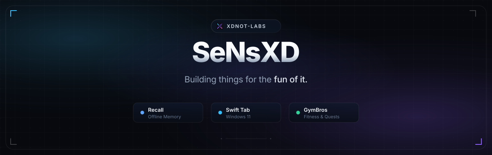

  

 

# Hey, I'm SeNsXD.

Building things for the fun of it.

I enjoy experimenting with ideas, exploring software, and turning random thoughts into polished, functional applications. All my personal projects are built under my creative umbrella brand, **xdNOT-Labs**.

---

### Featured Projects

<table>
  <tr>
    <td width="50%" valign="top">
      <h4><a href="https://github.com/SeNsXD/Recall">Recall</a></h4>
      
<b>Your memory. Your device. Your control.</b>

      
An offline-first personal memory app with an integrated on-device assistant (Echo) that never phones home. Notes, documents, passwords, locations, receipts, and spending analytics — 100% private and hardware-encrypted.

      
<code>Android</code> &bull; <code>Kotlin</code> &bull; <code>Jetpack Compose</code> &bull; <code>Offline-First</code>

    </td>
    <td width="50%" valign="top">
      <h4><a href="https://github.com/SeNsXD/Swift-Tab">Swift Tab</a></h4>
      
<b>A sleek taskbar companion for Windows 11 &amp; 10.</b>

      
Docks directly into your Windows taskbar with live interactive pills for media controls, weather forecasts, clipboard history, file shelf, and earbud battery levels. Lightweight native Rust.

      
<code>Windows 11 / 10</code> &bull; <code>Rust</code> &bull; <code>Direct2D</code> &bull; <code>Slint</code>

    </td>
  </tr>
  <tr>
    <td width="50%" valign="top">
      <h4><a href="https://github.com/SeNsXD/Widgetlabs">WidgetLabs</a></h4>
      
<b>Thoughtful widgets that make your home screen more useful.</b>

      
A modern collection of Android widgets featuring real-time earbuds battery monitoring &amp; ANC toggles, universal media playback controls, weather forecasts, and dynamic Material You themes.

      
<code>Android</code> &bull; <code>Kotlin</code> &bull; <code>Material You</code> &bull; <code>Customization</code>

    </td>
    <td width="50%" valign="top">
      <h4><a href="https://github.com/SeNsXD/GymBros">GymBros</a></h4>
      
<b>A modern fitness app that makes workout tracking engaging.</b>

      
Log sets, reps, PRs, and cardio with in-workout Spotify controls, Daily Quests, XP leveling, custom Move time rings, and encrypted Google Drive cloud backup.

      
<code>Android</code> &bull; <code>Kotlin</code> &bull; <code>Jetpack Compose</code> &bull; <code>Spotify Remote</code>

    </td>
  </tr>
</table>

---

### Stack &amp; Explorations

- **Platforms:** Android (Kotlin, Jetpack Compose, Material 3) &bull; Windows (Rust, Direct2D, Slint)
- **Architecture &amp; Focus:** Offline-first systems, local-only data sovereignty, on-device AI, desktop companions, tactile micro-interactions
- **Tools:** Android Studio, VS Code, Git &bull; Figma &amp; custom design systems

---

### Connect

- **Portfolio:** [rishabh-portfolio](https://rishabh-portfolio-wheat.vercel.app/)
- **X (Twitter):** [@rixh4bh](https://x.com/rixh4bh)
- **YouTube:** [@xdNOTLabs](https://www.youtube.com/@xdNOTLabs)
- **Brand:** **xdNOT-Labs**

 

  Ideas into software. &bull; Crafted under <b>xdNOT-Labs</b>

